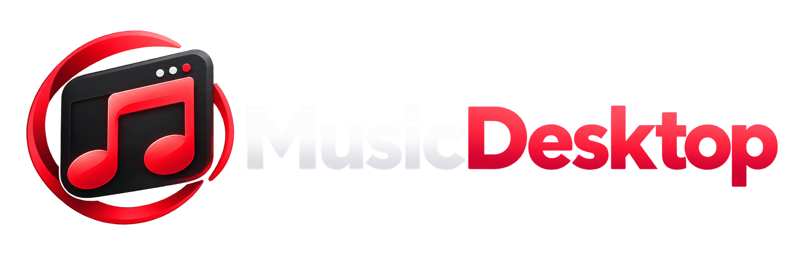
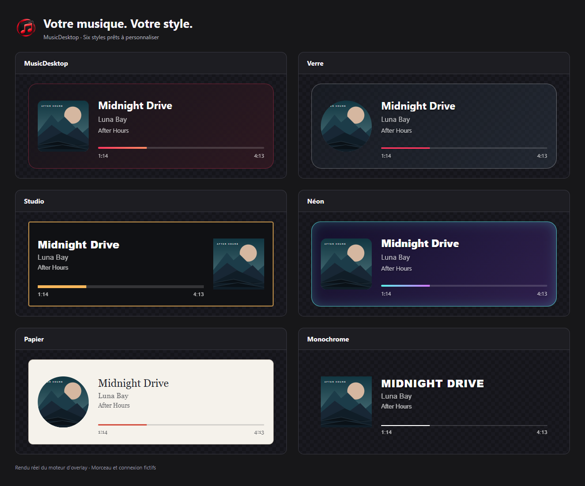

# Music Desktop

[English version](../en/README.md)

## YouTube Music à sa place.

**Music Desktop** est une application Windows dédiée à YouTube Music. Elle s’adresse à celles et ceux qui veulent simplement écouter leur musique sans laisser un navigateur ouvert uniquement pour un onglet de lecture.

Votre musique garde sa propre fenêtre, distincte de votre navigation, de vos recherches et de vos autres activités.

## Pourquoi Music Desktop ?

- Une fenêtre dédiée à YouTube Music, sans onglet de navigateur à garder ouvert.
- Un mini-lecteur qui reste accessible au-dessus des autres fenêtres.
- Des commandes simples pour continuer à écouter pendant que vous travaillez, jouez ou discutez.
- Une intégration Discord facultative pour afficher le morceau en cours d’écoute.
- L’association avec MusicDesktop Remote pour piloter la lecture depuis votre téléphone.

Music Desktop ne prétend pas transformer YouTube Music : l’objectif est simplement de lui donner une place plus naturelle sur Windows, dans une application pensée pour la musique.

## MusicDesktop Remote

Associez votre téléphone au PC depuis les paramètres de MusicDesktop. Vous pouvez ensuite contrôler la lecture, rechercher des titres et consulter la file d’attente à distance. La musique continue de jouer sur le PC.

## Studio Streamer

Avec MusicDesktop 2.0.3, ajoutez un overlay de votre morceau à OBS ou Streamlabs.
Six présentations et six styles personnalisables permettent de choisir le fond,
la pochette, les textes et la progression. Le panneau propose un aperçu, les
commandes et un guide ; enregistrez vos changements pour les appliquer à OBS.

Pilotez aussi la lecture avec l'[extension MusicDesktop pour Deckboard](https://github.com/Azashiin/MusicDesktop-Deckboard)
ou le plugin Elgato Stream Deck, disponibles dans **Panneau Streamer → Commandes**.
La capture audio se configure séparément dans votre logiciel de diffusion.

## 2.0.7 — Consolidation et optimisation

Auto Lyrics dispose d'un switch dans la barre supérieure et d'une file d'analyse
qui conserve les travaux en attente après redémarrage. Les résultats enregistrés
sont utilisés automatiquement dans Remote ; **Détails et paroles** permet de
consulter chaque morceau et son calage.

Cette version corrige l'ouverture de la liste des résultats et le risque de blocage
du switch, améliore le suivi du calcul et limite les traitements répétés et les
données temporaires en mémoire. Elle corrige aussi la lisibilité des langues
dans l'installateur. **Auto Lyrics reste facultatif et expérimental** ; les
synchronisations de YouTube Music ou LRCLIB restent prioritaires.

**Remote 1.0.5 reste compatible.** Consultez les [notes complètes](CHANGELOG.md).

## Correctif de la 2.0.6

Les playlists se chargent à nouveau dans Remote. Le choix d'une destination et
l'ajout du morceau en cours fonctionnent aussi pendant la navigation dans
YouTube Music, avec une confirmation fiable et une protection contre les doublons.
Installez cette mise à jour sur le PC ; **Remote 1.0.5 reste compatible**.

Cette édition corrige aussi les boutons de mise à jour du header et des
paramètres. Si vous utilisiez déjà la première 2.0.6, ou si ces boutons ne
répondent pas dans la 2.0.5, réinstallez le nouvel installateur complet.

## Nouveautés introduites en 2.0.5

- Paroles sur Remote, avec YouTube Music et LRCLIB ; moteur local facultatif
  **expérimental** pour les textes sans synchronisation.
- File réorganisable et gestion des playlists du compte YouTube Music connecté
  sur le PC, avec **Remote 1.0.5 ou une version compatible**.
- Connexion Last.fm et enregistrement des écoutes sur activation explicite.
- Trois thèmes : MusicDesktop, Akyraïs et Asashiin.
- Suivi détaillé du téléchargement des mises à jour, puis redémarrage choisi.
- Streamer OFF au lancement et switch ON/OFF dans la barre supérieure.

Le moteur de paroles se télécharge séparément ; sa capture audio nécessite
Windows 11 et sa précision varie selon les morceaux. Remote reste en test fermé
Android : [rejoindre les tests](https://musicdesktop.net/fr/remote.html).

## Télécharger

➡️ **[Télécharger la dernière version de Music Desktop](https://github.com/Azashiin/Music-Desktop-Releases/releases/latest)**

L’installateur est disponible pour Windows 64 bits dans la page de chaque release. Le même fichier sert au français et à l’anglais : choisissez votre langue pendant l’installation, puis changez-la à tout moment dans les paramètres.

Les nouvelles versions peuvent être vérifiées et installées depuis les paramètres de MusicDesktop.

Consultez les [notes de mise à jour](CHANGELOG.md) pour découvrir les évolutions de chaque version.

## À propos

Music Desktop est une application indépendante. Elle n’est pas affiliée à YouTube, Google ou Discord. Votre connexion à YouTube Music reste gérée par Google.

Ce dépôt sert uniquement à publier les versions de Music Desktop : aucun code source de l’application n’y est distribué.
